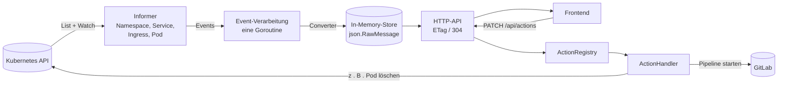

# Feature-Environment-Dashboard

Ein Dashboard, in dem Software-Entwickler sehen, welche **Feature-Umgebungen** (Namespaces) sie in einem
Kubernetes-Cluster hochgefahren haben und welche **Services, Ingresses und Pods** darin laufen. Über das Dashboard
lassen sich außerdem **Aktionen** auf diesen Objekten auslösen, z. B. einen Pod löschen, einen NodePort-Service
anlegen oder eine GitLab-Pipeline starten. Konfigurierbare **Links** springen von Objekten in andere Systeme, etwa
zu den Logs in Kibana.

Das Projekt besteht aus zwei Teilen:

| Teil     | Technik                                               | Ordner      |
|----------|-------------------------------------------------------|-------------|
| Backend  | Go, `client-go` v0.33 (Informer), `net/http`          | `backend/`  |
| Frontend | React 19, TypeScript, Vite, MUI, React Router, Lucide | `frontend/` |

Im Cluster liefert das Backend auch das gebaute Frontend aus. Es gibt ein Image und genau ein Deployment mit **einem**
Replica.

---

## Inhalt

1. [Schnellstart](#schnellstart)
2. [Fachliche Begriffe](#fachliche-begriffe)
3. [Architektur des Backends](#architektur-des-backends)
4. [Kommandozeile des Backends](#kommandozeile-des-backends)
5. [Konfiguration (`config.yaml`)](#konfiguration-configyaml)
    - [Übersicht](#übersicht)
    - [`projects`](#projects)
    - [`actionHandlers`](#actionhandlers)
    - [Mitgelieferte Aktionen](#mitgelieferte-aktionen)
    - [`links` und `link-variables`](#links-und-link-variables)
    - [Templates in der Konfiguration](#templates-in-der-konfiguration)
    - [`cluster`](#cluster)
    - [`store`](#store)
    - [`frontend`](#frontend)
    - [Prüfungen beim Start](#prüfungen-beim-start)
    - [Vollständiges Beispiel](#vollständiges-beispiel)
6. [HTTP-API](#http-api)
7. [Eine eigene Aktion entwickeln](#eine-eigene-aktion-entwickeln)
8. [Deployment im Cluster](#deployment-im-cluster)
9. [Entwicklung](#entwicklung)
10. [Fehlersuche](#fehlersuche)

---

## Schnellstart

Voraussetzungen: Go 1.26, Node.js 22, ein erreichbarer Kubernetes-Cluster (z. B. kind oder minikube) und eine
kubeconfig.

```sh
# Frontend bauen und Backend lokal starten (nutzt KUBECONFIG bzw. ~/.kube/config)
make run

# danach im Browser http://localhost:8080 öffnen
```

`make run` verwendet `backend/config.example.yaml`. Eine eigene Konfiguration gibst du so an:

```sh
make run CONFIG=pfad/zur/config.yaml          # Pfad relativ zum Repository-Root
```

Für die Frontend-Entwicklung mit Hot-Reload startest du Backend und Vite-Dev-Server getrennt:

```sh
make backend-run      # Backend auf :8080
make frontend-dev     # Vite-Dev-Server; leitet /api an localhost:8080 weiter
```

Damit das Dashboard etwas anzeigt, braucht ein Namespace die Labels eines konfigurierten Projekts. Für
`foo-projekt` aus der Beispiel-Config:

```sh
kubectl create namespace feat-login
kubectl label namespace feat-login \
  mycomp.de/is-feature-environment=true \
  mycomp.de/project-name=foo-projekt \
  mycomp.de/organization-unit=development
```

Ein Helm-Chart mit einer Demo-Anwendung liegt unter `helpers/demo-app`.

---

## Fachliche Begriffe

| Begriff            | Bedeutung                                                                                      |
|--------------------|------------------------------------------------------------------------------------------------|
| Projekt            | In der `config.yaml` definiert. Hat mehrere Feature-Umgebungen.                                |
| Feature-Umgebung   | Genau ein Namespace, der über seine Labels genau einem Projekt zugeordnet ist.                 |
| Anwendungs-Service | Ein Kubernetes-Service vom Typ `ClusterIP`.                                                    |
| NodePort-Service   | Ein Kubernetes-Service vom Typ `NodePort`. Erreichbar unter `<cluster.dns-name>:<nodePort>`.   |
| Replica            | Ein Pod, der von einem Service über dessen Selector referenziert wird.                         |
| Service-Bereich    | Je Projekt konfigurierte Gruppe von Anwendungs-Services, zugeordnet über Service-Labels.       |
| Stored-Object      | Die reduzierte, konvertierte Form eines Kubernetes-Objekts im In-Memory-Store.                 |
| Aktion             | Eine vom Dashboard auslösbare Operation auf einem Objekt, umgesetzt durch einen ActionHandler. |
| Link               | Ein konfigurierter Absprung von einem Objekt in ein anderes System (z. B. Kibana).             |

---

## Architektur des Backends



### Anbindung an Kubernetes

- Das Backend nutzt die **Informer-API** von `client-go` (`SharedInformerFactory`). Es werden genau vier
  Objekt-Typen beobachtet: **Namespace, Service, Ingress (`networking.k8s.io/v1`) und Pod**, clusterweit.
- **Ein Event trägt nur den Schlüssel des Objekts.** Den aktuellen Zustand liest die Verarbeitung zum Zeitpunkt der
  Verarbeitung aus dem Informer-Cache. Ist das Objekt dort nicht mehr vorhanden, wird es aus dem Store entfernt.
- **Alle Events und Neuaufbauten laufen nacheinander in einer einzigen Goroutine.** Abhängige Änderungen können sich
  dadurch nicht überholen.
- **Nur Feature-Umgebungen werden verarbeitet.** Ein Namespace gehört zu einem Projekt, wenn er *alle* in
  `namespace-labels` genannten Labels mit genau diesen Werten trägt. Objekte in anderen Namespaces werden verworfen.
    - Bekommt ein Namespace nachträglich die passenden Labels, übernimmt das Backend sofort alle seine Objekte.
    - Verliert er sie, verschwindet er samt Inhalt aus dem Store.

### Converter und Referenzauflösung

Von jedem Objekt werden nur Kern-Informationen übernommen:

| Objekt    | Gespeichert                                                                                              |
|-----------|----------------------------------------------------------------------------------------------------------|
| alle      | Name, Namespace, Labels, Annotations                                                                     |
| Namespace | zusätzlich das zugeordnete Projekt                                                                       |
| Pod       | Phase, Ready-Zustand, Container (Name, Image, Ports)                                                     |
| Service   | Typ, Selector, Ports (Name, Protokoll, Port, Target-Port, aufgelöster Target-Port, NodePort), Replicas   |
| Ingress   | je Regel: Host und je Pfad: Pfad-Typ, Pfad, Backend (Service, Port-Name/-Nummer, aufgelöste Port-Nummer) |

Beim Konvertieren werden **Referenzen aufgelöst**:

- **Service:** Die *Replicas* sind die Pods im Namespace, deren Labels den Selector erfüllen. Ein benannter
  `targetPort` (z. B. `http`) wird über die Container-Ports dieser Pods zur Port-Nummer aufgelöst.
- **Ingress:** Ein Backend, das den Service-Port per Name referenziert, bekommt die Port-Nummer des Services.

Eine Änderung an einem Objekt kann dadurch andere Stored-Objects betreffen. Deshalb wird nach jeder Änderung in
derselben Transaktion neu aufgelöst:

- Nach einem Pod-Event: alle Services und danach alle Ingresses des Namespaces.
- Nach einem Service-Event: alle Ingresses des Namespaces.

### In-Memory-Store

- **Alles liegt im Speicher, es gibt keine Datenbank.** Gespeichert wird als `json.RawMessage`. Beim Schreiben wird
  serialisiert, beim Lesen deserialisiert. So hält niemand einen Pointer auf den Zustand im Store, und jeder Leser
  bekommt eine Kopie.
- **Nebenläufigkeit:** Ein `sync.RWMutex` schützt den Store. Änderungen laufen als Transaktion (`Store.Update`), damit
  Leser zusammengehörige Änderungen auf einmal sehen.
- **Zeitstempel für ETags:** Der Store führt zwei Arten von Zeitstempeln. Gesetzt werden sie nur, wenn sich das
  gespeicherte JSON tatsächlich ändert:
    - einen für Änderungen an Namespaces von Projekten (hinzugefügt, geändert, entfernt),
    - je Namespace einen für Änderungen an Objekten darin oder am Namespace selbst.
- **Periodischer Neuaufbau** (`store.recreate-store-interval`):
    1. Das Backend startet frische Informer, baut daraus einen komplett neuen Store-Inhalt und tauscht ihn auf einmal
       aus.
    2. Zeitstempel ändern sich nur für Namespaces, deren Inhalt sich unterscheidet. Ein Neuaufbau ohne Änderungen löst
       im Frontend also kein Neuladen aus.

### Aktionen

- **Eine Instanz je Aktion:** Jede Aktion in `actionHandlers` wird beim Start einem **Handler-Typ** zugeordnet. Die
  **ActionRegistry** erzeugt daraus genau eine Handler-Instanz.
- **Sichtbarkeit:** Ob eine Aktion an einem Objekt angeboten wird, entscheiden zwei Stellen. Zuerst prüft die
  Registry das Projekt (`projects`), dann entscheidet der Handler selbst (`IsApplicable`). Benötigt der Handler
  Eingaben, beschreibt er sie als Formular-Felder, und das Frontend baut daraus generisch ein Formular.
- **Kein Schreiben in den Store:** Ein Handler verändert nur den Cluster oder ein externes System. Die Änderung
  kommt ausschließlich über die Informer-Events in den Store.

### Links

Links werden aus Go-Templates gerendert. Die Template-Daten stammen aus dem Objekt, seinem Projekt und statischen
Variablen. Das Backend liefert fertige URLs aus, das Frontend zeigt sie nur noch an. Details stehen unter
[`links` und `link-variables`](#links-und-link-variables).

### Paketstruktur

| Paket                              | Aufgabe                                                                    |
|------------------------------------|----------------------------------------------------------------------------|
| `cmd/dashboard`                    | Start, Flags, Verdrahtung, Registrierung der Handler-Typen                 |
| `internal/config`                  | `config.yaml` laden und prüfen                                             |
| `internal/model`                   | Stored-Object-Strukturen                                                   |
| `internal/project`                 | Namespace-Labels → Projekt; Zuordnung zu Service-Bereichen                 |
| `internal/store`                   | In-Memory-Store, Transaktionen, Zeitstempel                                |
| `internal/converter`               | k8s-Objekt → Stored-Object, Referenzauflösung                              |
| `internal/kube`                    | Kubernetes-Client, Informer, Event-Verarbeitung, Neuaufbau                 |
| `internal/actions`                 | Handler-Interface, ActionRegistry, Prüfung der Formular-Eingaben           |
| `internal/actions/deletepod`       | Aktion `delete-pod`                                                        |
| `internal/actions/nodeportservice` | Aktionen `node-port-service-on-service-base`, `delete-node-port-service`   |
| `internal/actions/restartservice`  | Aktion `restart-service-replicas`                                          |
| `internal/actions/gitlabpipeline`  | Handler-Typ `gitlab-pipeline`                                              |
| `internal/actions/missingservices` | Handler-Typ `deploy-missing-services`                                      |
| `internal/objecttemplate`          | Go-Templates mit Objekt-Daten (für Links und `gitlab-pipeline`)            |
| `internal/links`                   | Rendert die konfigurierten Links je Objekt                                 |
| `internal/api`                     | HTTP-API, ETag/304, `openapi.yaml`, Swagger-UI, Auslieferung des Frontends |

---

## Kommandozeile des Backends

```sh
dashboard --config config.yaml --listen :8080 [--kubeconfig PFAD] [--static-dir PFAD]
```

| Flag           | Standard      | Bedeutung                                                                                          |
|----------------|---------------|----------------------------------------------------------------------------------------------------|
| `--config`     | `config.yaml` | Pfad zur Konfiguration                                                                             |
| `--listen`     | `:8080`       | HTTP-Adresse                                                                                       |
| `--kubeconfig` | leer          | Leer: In-Cluster-Konfiguration, ersatzweise `KUBECONFIG` bzw. `~/.kube/config`. Sonst dieser Pfad. |
| `--static-dir` | leer          | Verzeichnis mit dem Frontend-Build. Leer: Das Frontend wird nicht ausgeliefert.                    |

Ablauf beim Start:

1. Die Konfiguration wird gelesen und vollständig geprüft. Bei einem Fehler bricht der Start ab, siehe
   [Prüfungen beim Start](#prüfungen-beim-start).
2. Die Handler aller aktiven Aktionen werden erzeugt und konfiguriert, die Link-Templates werden geparst.
3. Der HTTP-Server startet sofort. `/readyz` meldet erst nach dem ersten erfolgreichen Aufbau des Stores `200`.
   Schlägt der Aufbau fehl, etwa wegen eines nicht erreichbaren Clusters, versucht das Backend es alle 10 Sekunden
   erneut. Für die Synchronisierung der Informer gilt ein Timeout von 2 Minuten.

Bei `SIGINT`/`SIGTERM` fährt das Backend geordnet herunter.

---

## Konfiguration (`config.yaml`)

Die Konfiguration wird **einmal beim Start** gelesen. Änderungen werden erst nach einem Neustart wirksam.

### Übersicht

| Schlüssel        | Pflicht | Inhalt                                                               |
|------------------|---------|----------------------------------------------------------------------|
| `projects`       | ja      | Projekte, ihre Namespace-Labels, Service-Bereiche und Link-Variablen |
| `actionHandlers` | nein    | Aktionen, die das Dashboard anbietet                                 |
| `links`          | nein    | Links von Objekten in andere Systeme                                 |
| `link-variables` | nein    | Statische Variablen für Link-Templates                               |
| `cluster`        | nein    | Angaben zum Cluster, z. B. der DNS-Name der Nodes                    |
| `store`          | nein    | Verhalten des In-Memory-Stores                                       |
| `frontend`       | nein    | Wählbare Abfrage-Intervalle des Frontends, Default und Sperrzeit     |

> **YAML-Hinweise**
> - Unquotierte Werte wie `true` oder `8080` werden bei Labels und Variablen als Text gelesen. `true` passt also
>   zum Label-Wert `"true"`.
> - Werte, die mit `{{` beginnen, müssen in Anführungszeichen stehen. Sonst liest YAML `{` als Beginn eines
>   Mappings.
> - Wiederkehrende Blöcke lassen sich mit YAML-Ankern (`&name` / `*name`) wiederverwenden.

### `projects`

```yaml
projects:
  - project-name: foo-projekt                      # eindeutiger Name des Projekts
    namespace-labels: # ALLE Labels müssen am Namespace gesetzt sein
      mycomp.de/is-feature-environment: true
      mycomp.de/project-name: foo-projekt
    others-area-label: Andere                      # optional
    service-areas: # optional
      - area-name: business-services
        area-label: Business
        label-combinations:
          - app.kubernetes.io/part-of: shop
            app.kubernetes.io/component: backend
          - app.kubernetes.io/part-of: billing
    link-variables-overrides: # optional
      kibanaDataView: logs-foo
```

| Feld                       | Pflicht | Bedeutung                                                                                                                   |
|----------------------------|---------|-----------------------------------------------------------------------------------------------------------------------------|
| `project-name`             | ja      | Eindeutiger Name. Er wird in `projects` von Aktionen und Links referenziert.                                                |
| `namespace-labels`         | ja      | Labels samt Werten, die ein Namespace **alle** tragen muss, um zum Projekt zu gehören. Darf nicht leer sein.                |
| `service-areas`            | nein    | Teilt die Anwendungs-Services im Dashboard in Bereiche auf.                                                                 |
| `others-area-label`        | nein    | Überschrift des Bereichs für nicht zugeordnete Services. Standard ist „Andere“, ohne `service-areas` „Anwendungs-Services“. |
| `link-variables-overrides` | nein    | Überschreibt oder ergänzt die globalen `link-variables` für dieses Projekt.                                                 |

**Zuordnung von Namespaces:** Passt ein Namespace zu mehreren Projekten, gewinnt das erste in der Reihenfolge der
Config. Das Backend loggt dazu eine Warnung.

#### Service-Bereiche (`service-areas`)

Service-Bereiche gruppieren die **Anwendungs-Services (Typ `ClusterIP`)** auf der Namespace-Seite. Die NodePort-Liste
ist davon nicht betroffen.

| Feld                 | Pflicht | Bedeutung                                                        |
|----------------------|---------|------------------------------------------------------------------|
| `area-name`          | ja      | ID des Bereichs, eindeutig je Projekt. `others` ist reserviert.  |
| `area-label`         | ja      | Überschrift im Dashboard                                         |
| `label-combinations` | ja      | Liste von Label-Kombinationen. Keine Kombination darf leer sein. |

Ein Service gehört zu einem Bereich, wenn er **alle Labels mindestens einer Kombination** trägt: ODER über die
Einträge, UND innerhalb eines Eintrags.

- **Mehrere Bereiche:** Ein Service kann in mehreren Bereichen stehen.
- **Rest:** Services ohne passenden Bereich landen im Bereich `others`.
- **Reihenfolge:** Die Bereiche erscheinen in der Reihenfolge der Config, `others` immer zuletzt.
- **Leere Bereiche:** Konfigurierte Bereiche werden auch leer angezeigt. `others` erscheint nur, wenn er Services
  enthält, oder wenn das Projekt keine Bereiche hat.

Im Dashboard filtert eine Chip-Leiste die Bereiche, mit Mehrfachauswahl. Die Auswahl steht in der URL (`?area=<id>`).

### `actionHandlers`

```yaml
actionHandlers:
  - action-name: delete-pod                 # eindeutige Aktion-ID
    handler: delete-pod                     # optional; Standard: action-name
    action-title: Pod löschen               # Tooltip im Dashboard
    lucide-icon: trash                      # Name eines Lucide-Icons (https://lucide.dev/icons)
    lucide-icon-color: red                  # beliebige CSS-Farbe
    projects: [ foo-projekt, bar-projekt ]    # Pflicht; [] = deaktiviert
    extra-handler-configs: # handlerspezifisch
      force-delete: true
```

| Feld                    | Pflicht | Bedeutung                                                                                                                                                                            |
|-------------------------|---------|--------------------------------------------------------------------------------------------------------------------------------------------------------------------------------------|
| `action-name`           | ja      | Eindeutige ID der Aktion. Sie steht im Pfad von `PATCH /api/actions/{action-name}`.                                                                                                  |
| `handler`               | nein    | Handler-Typ. Fehlt er, gilt `action-name` als Handler-Typ. Ein Handler-Typ wie `gitlab-pipeline` kann so mehrere Aktionen bedienen.                                                  |
| `action-title`          | nein    | Titel, im Dashboard als Tooltip am Icon                                                                                                                                              |
| `lucide-icon`           | nein    | Icon-Name. Unbekannte Namen zeigen ein Platzhalter-Icon.                                                                                                                             |
| `lucide-icon-color`     | nein    | Icon-Farbe als CSS-Wert, z. B. `red` oder `#00bfb3`                                                                                                                                  |
| `projects`              | ja      | Projekte, in denen die Aktion angeboten und ausführbar ist. **`[]` deaktiviert die Aktion**: Ihr Handler wird dann nicht erzeugt. Es wird nur geprüft, ob der Handler-Typ existiert. |
| `extra-handler-configs` | nein    | Handlerspezifische Einstellungen, siehe unten                                                                                                                                        |

Das Dashboard zeigt Aktionen als Icon-Buttons. Vor dem Ausführen öffnet sich immer ein Bestätigungsdialog. Hat die
Aktion Formular-Felder, stehen sie in diesem Dialog. Das Ergebnis erscheint als Meldung.

### Mitgelieferte Aktionen

| Handler-Typ                         | Objekt         | Wirkung                                                         |
|-------------------------------------|----------------|-----------------------------------------------------------------|
| `delete-pod`                        | Pod            | Löscht den Pod                                                  |
| `node-port-service-on-service-base` | Service        | Erstellt zu einem ClusterIP-Service einen NodePort-Service      |
| `delete-node-port-service`          | Service        | Löscht einen von der vorigen Aktion erstellten NodePort-Service |
| `restart-service-replicas`          | Service        | Löscht alle Pods eines Services, damit sie neu starten          |
| `gitlab-pipeline`                   | konfigurierbar | Startet eine GitLab-Pipeline, beliebig viele Aktionen möglich   |
| `deploy-missing-services`           | Namespace      | Startet eine GitLab-Pipeline für fehlende Services              |

#### `delete-pod`

Löscht den Pod, an dem die Aktion ausgelöst wird. Die Aktion erscheint auf der Rückseite der Service-Kachel, also
nach einem Klick auf ein Replica.

| `extra-handler-configs` | Standard | Bedeutung                                                  |
|-------------------------|----------|------------------------------------------------------------|
| `force-delete`          | `false`  | `true` löscht ohne Grace-Period (`gracePeriodSeconds: 0`). |

#### `node-port-service-on-service-base`

Erstellt zu einem ClusterIP-Service einen Service vom Typ `NodePort` mit dem Namen **`<service>-node-port`**.

- **Angeboten** wird die Aktion an Services, die alle diese Bedingungen erfüllen:
    - Der Service ist vom Typ `ClusterIP`.
    - Er hat einen Selector und mindestens einen Port.
    - Im Namespace gibt es noch keinen Service `<service>-node-port`.
    - Der neue Name ist ein gültiger Service-Name, also höchstens 63 Zeichen lang.
- **Formular:** Ein Pflichtfeld „Target-Ports“ als Mehrfachauswahl, mit den Ports des Basis-Services.
- **Erstellt** wird ein Service mit:
    - demselben Selector,
    - den ausgewählten Port-Mappings (Name, Protokoll, Port, Target-Port),
    - zufällig vergebenen NodePorts,
    - einer `ownerReference` auf den Basis-Service.
- **Kennzeichnung:** Label `feature-dashboard/created-by-action: node-port-service-on-service-base`, Label
  `app.kubernetes.io/managed-by: feature-dashboard` und Annotation `feature-dashboard/base-service: <service>`.
- **Erneute Prüfung:** Vor dem Erstellen liest die Aktion den Basis-Service frisch aus dem Cluster. Fehlt er oder ist
  er nicht mehr vom Typ `ClusterIP`, schlägt die Aktion fehl.
- **Lebensdauer:** Wird der Basis-Service gelöscht, löscht Kubernetes (Garbage-Collector) über die `ownerReference`
  auch den NodePort-Service. NodePort-Services, die vor Einführung der `ownerReference` erstellt wurden, bleiben
  dabei erhalten und müssen über `delete-node-port-service` oder manuell gelöscht werden.

Keine `extra-handler-configs`.

#### `delete-node-port-service`

Löscht einen NodePort-Service, aber nur, wenn er das Label
`feature-dashboard/created-by-action: node-port-service-on-service-base` trägt. Manuell angelegte Services bleiben
unberührt.

- **Erneute Prüfung:** Vor dem Löschen liest die Aktion den Service frisch aus dem Cluster und prüft das Label noch
  einmal.
- **UID-Prüfung:** Gelöscht wird mit einer UID-Prüfung, damit nicht versehentlich ein zwischenzeitlich neu angelegter
  Service gleichen Namens erwischt wird.

Keine `extra-handler-configs`.

#### `restart-service-replicas`

Löscht alle Pods, die der Service selektiert, damit ihr Controller sie neu startet.

- **Angeboten** an Services mit Selector und mindestens einem Replica. Ausgenommen sind NodePort-Services, die das
  Dashboard selbst erstellt hat.
- **Aktueller Stand:** Die Pods werden beim Ausführen frisch aus dem Cluster gelesen.
- **Nur Pods mit Controller** wie einem ReplicaSet werden gelöscht. Pods ohne Controller würden nicht neu entstehen;
  die Aktion überspringt sie und nennt sie in der Meldung. Pods, die bereits gelöscht werden, werden übersprungen.
- **Schutz:** Ohne Selector wird nichts gelöscht, denn ein leerer Selector träfe alle Pods im Namespace.

Keine `extra-handler-configs`.

#### `gitlab-pipeline`

Generischer Handler-Typ. Er startet über die
[Pipeline-Trigger-API](https://docs.gitlab.com/ee/ci/triggers/) eine GitLab-Pipeline. Beliebig viele Aktionen
können ihn nutzen, sie unterscheiden sich nur in ihrer Konfiguration.

```yaml
  - action-name: deploy-feature
    handler: gitlab-pipeline
    action-title: Feature deployen
    lucide-icon: rocket
    lucide-icon-color: green
    projects: [ foo-projekt ]
    extra-handler-configs:
      gitlab-url: https://gitlab.mycomp.de
      project: team/foo-deploy
      ref: "feature/{{ .Namespace }}"
      token-env: GITLAB_TRIGGER_TOKEN_FOO
      applies-to: [ namespace ]
      timeout: 15s
      variables:
        NAMESPACE: "{{ .Namespace }}"
        ACTION: deploy
```

| `extra-handler-configs` | Pflicht | Bedeutung                                                                                                    |
|-------------------------|---------|--------------------------------------------------------------------------------------------------------------|
| `gitlab-url`            | ja      | Basis-URL von GitLab (`http`/`https`)                                                                        |
| `project`               | ja      | Projekt-ID oder Projektpfad, z. B. `team/foo-deploy`. Wird automatisch kodiert.                              |
| `ref`                   | ja      | Branch oder Tag. [Template](#templates-in-der-konfiguration) erlaubt.                                        |
| `token-env`             | ja      | Name der Umgebungsvariable mit dem Pipeline-Trigger-Token. Ist sie nicht gesetzt, startet das Backend nicht. |
| `applies-to`            | ja      | Objekt-Typen, an denen die Aktion erscheint: `namespace`, `service`, `ingress`, `pod`                        |
| `timeout`               | nein    | Timeout des HTTP-Aufrufs, Standard `10s`                                                                     |
| `variables`             | nein    | Pipeline-Variablen. Die Werte sind Templates.                                                                |

- **Aufruf:** `POST {gitlab-url}/api/v4/projects/{project}/trigger/pipeline` mit `token`, `ref` und
  `variables[KEY]=value`.
- **Ergebnis:** Bei Erfolg meldet das Dashboard „Pipeline #<id> gestartet: <Link>“. Bei Fehlern erscheinen der
  HTTP-Status und die Fehlermeldung von GitLab.
- **Token-Schutz:** Das Token erscheint nie in Logs oder Meldungen.
- **Fehlende Template-Werte:** Kann ein Template nicht gerendert werden, z. B. wegen eines fehlenden Werts, wird
  nichts an GitLab gesendet.

> **Tokens gehören nicht in die `config.yaml`.** Im Cluster kommen sie aus dem Secret `feature-dashboard-gitlab`
> (siehe [Deployment](#deployment-im-cluster)). Das Deployment lädt alle Schlüssel dieses Secrets als
> Umgebungsvariablen.

#### `deploy-missing-services`

Gleicht die konfigurierten Services mit den Services im Namespace ab, verglichen wird der Service-Name. Der Dialog
bietet die fehlenden Services als Mehrfachauswahl an. Für die Auswahl startet der Handler **eine** GitLab-Pipeline,
genau wie bei [`gitlab-pipeline`](#gitlab-pipeline). Die gewählten Services stehen in den Templates als `.Services`.

```yaml
  - action-name: deploy-missing-services
    action-title: Fehlende Services deployen
    lucide-icon: package-plus
    lucide-icon-color: green
    projects: [ foo-projekt ]
    extra-handler-configs:
      services:
        - name: foo-backend
          label: Foo Backend
        - name: foo-frontend
      gitlab-url: https://gitlab.mycomp.de
      project: team/foo-deploy
      ref: main
      token-env: GITLAB_TRIGGER_TOKEN_FOO
      variables:
        NAMESPACE: "{{ .Namespace }}"
        SERVICES: '{{ join .Services "," }}'
```

| `extra-handler-configs` | Pflicht | Bedeutung                                                                       |
|-------------------------|---------|---------------------------------------------------------------------------------|
| `services`              | ja      | Erwartete Services, mindestens einer. Je Eintrag `name` (eindeutig) und optional `label` für die Anzeige, Standard ist `name`. |
| `gitlab-url` … `variables` | wie bei `gitlab-pipeline` | ohne `applies-to`, die Aktion gilt immer für Namespaces |

- **Nichts fehlt:** Die Aktion bleibt sichtbar. Das Dropdown ist dann leer und die Ausführung wird abgelehnt.
- **Prüfung:** Ausgewählt werden dürfen nur Services, die zum Zeitpunkt der Ausführung noch fehlen.

### `links` und `link-variables`

Links erscheinen im Dashboard als Icon mit Tooltip und öffnen in einem neuen Tab:

- bei Namespace, Ingresses und Services rechts neben den Aktionen, durch einen Trennstrich abgesetzt,
- bei Pods neben dem Status in der Replica-Liste und auf der Rückseite der Service-Kachel.

```yaml
link-variables: # statische Werte, im Template unter .Vars
  kibanaDiscover: https://kibana.mycomp.de/app/discover#/?_g=(time:(from:now-1h,to:now))
  kibanaDataView: logs-k8s

projects:
  - project-name: foo-projekt
    # ...
    link-variables-overrides: # gewinnt gegenüber link-variables
      kibanaDataView: logs-foo

links:
  - link-id: kibana-logs                          # eindeutig
    title: Logs in Kibana                         # Tooltip
    lucide-icon: scroll-text
    lucide-icon-color: "#00bfb3"
    projects: [ foo-projekt, bar-projekt ]          # Pflicht; [] = in keinem Projekt
    targets: # je Objekt-Typ genau eine URL
      namespace:
        url: |-
          {{ .Vars.kibanaDiscover }}&_a=(dataSource:(dataViewId:{{ rison .Vars.kibanaDataView }},type:dataView),
          query:(language:kuery,query:{{ rison (printf "kubernetes.namespace:%q" .Namespace) }}))
      pod:
        url: |-
          {{ .Vars.kibanaDiscover }}&_a=(dataSource:(dataViewId:{{ rison .Vars.kibanaDataView }},type:dataView),
          query:(language:kuery,query:{{ rison (printf "kubernetes.namespace:%q and kubernetes.pod.name:%q" .Namespace .Name) }}))
      service: # Logs aller Pods, die der Service selektiert
        url: |-
          {{ .Vars.kibanaDiscover }}&_a=(dataSource:(dataViewId:{{ rison .Vars.kibanaDataView }},type:dataView),
          query:(language:kuery,query:'kubernetes.namespace:"{{ .Namespace }}"
          {{- range $k, $v := .Selector }} and kubernetes.labels.{{ replace $k "." "_" }}:"{{ $v }}"{{ end }}'))
```

| Feld                | Pflicht | Bedeutung                                                                                                                                                           |
|---------------------|---------|---------------------------------------------------------------------------------------------------------------------------------------------------------------------|
| `link-id`           | ja      | Eindeutige ID                                                                                                                                                       |
| `title`             | ja      | Tooltip im Dashboard                                                                                                                                                |
| `lucide-icon`       | nein    | Icon-Name                                                                                                                                                           |
| `lucide-icon-color` | nein    | Icon-Farbe                                                                                                                                                          |
| `projects`          | ja      | Projekte, in denen der Link angeboten wird. `[]` heißt in keinem Projekt, beim Start gibt es dazu eine Warnung.                                                     |
| `targets`           | ja      | Je Objekt-Typ (`namespace`, `service`, `ingress`, `pod`) ein Eintrag mit `url`. Nicht aufgeführte Typen haben den Link nicht. Ein Target ohne `url` ist ein Fehler. |
| `targets.<typ>.url` | ja      | [Template](#templates-in-der-konfiguration) für die Ziel-URL                                                                                                        |

**Wichtig bei URLs:**

- **Kodierung:** Werte kodierst du im Template selbst. Für Query-Parameter nimmst du `urlquery`, für Pfadteile
  `pathescape`, für Kibana-Parameter `rison`. Werte ohne Funktion landen unverändert in der URL.
- **Umbrechen:** Lange URLs brichst du mit dem YAML-Blockstil **`|-`** um. Zeilenumbrüche samt Einrückung werden
  entfernt. **Nicht `>-` verwenden**, denn das macht aus Zeilenumbrüchen Leerzeichen, und die landen in der URL.
- **Gemeinsame Teile:** Was mehrere Targets gemeinsam haben, gehört in `link-variables`, etwa die
  Kibana-Discover-Basis.
- **Absolute URLs:** Nur absolute `http(s)`-URLs werden ausgeliefert. Alles andere, z. B. `javascript:`, wird
  verworfen.
- **Fehler beim Rendern:** Lässt sich ein Link für ein Objekt nicht rendern, wird nur dieser Link weggelassen und
  eine Warnung geloggt. Typische Ursachen sind eine fehlende Variable oder eine ungültige URL.

### Templates in der Konfiguration

Templates in Links und bei `gitlab-pipeline` bzw. `deploy-missing-services` (`ref`, `variables`) sind
[Go-Templates](https://pkg.go.dev/text/template).

**Verfügbare Daten:**

| Feld           | Inhalt                                                                                    |
|----------------|-------------------------------------------------------------------------------------------|
| `.Kind`        | `namespace`, `service`, `ingress` oder `pod`                                              |
| `.Name`        | Name des Objekts, bei einem Namespace dessen Name                                         |
| `.Namespace`   | Namespace des Objekts                                                                     |
| `.Project`     | Dashboard-Projekt des Namespaces                                                          |
| `.Labels`      | Labels des Objekts                                                                        |
| `.Annotations` | Annotations des Objekts                                                                   |
| `.Selector`    | Selector eines Services, bei anderen Objekten leer                                        |
| `.Vars`        | `link-variables`, überschrieben durch `link-variables-overrides`. Nur in Links verfügbar. |
| `.Services`    | Gewählte Services, nur bei `deploy-missing-services` gefüllt, sonst leer                  |

**Zusätzliche Funktionen** neben den Go-Standardfunktionen wie `urlquery`, `index`, `printf`, `range` und `if`:

| Funktion     | Beispiel                                    | Ergebnis                         |
|--------------|---------------------------------------------|----------------------------------|
| `rison`      | `{{ rison "it's" }}`                        | `'it!'s'` (Kibana-Notation)      |
| `pathescape` | `{{ pathescape "team/foo" }}`               | `team%2Ffoo`                     |
| `replace`    | `{{ replace "app.kubernetes.io" "." "_" }}` | `app_kubernetes_io`              |
| `join`       | `{{ join .Liste ", " }}`                    | verbindet eine Liste von Strings |

**Fallstricke:**

- **Fehlende Map-Schlüssel:** Ein Zugriff wie `.Vars.gibtsNicht` ist ein **Fehler** und liefert keinen leeren Text.
- **Labels mit `.` oder `/` im Namen:** Hier nimmst du `index`, z. B. `{{ index .Labels "app.kubernetes.io/name" }}`.
  Ein fehlendes Label liefert dabei einen leeren Text.
- **Unbekannte Felder:** Ein Feld wie `.Service` gibt es nicht. Der Name des Objekts steht immer in `.Name`.
- **Wann Fehler auffallen:** Syntaxfehler fallen beim Start auf. Unbekannte Felder und fehlende Werte fallen erst auf,
  wenn das Template für ein konkretes Objekt gerendert wird. Bei Links wird dann nur der betroffene Link weggelassen,
  bei `gitlab-pipeline` schlägt die Aktion mit einer Meldung fehl.
- **Leerzeichen als `+`:** `urlquery` kodiert Leerzeichen als `+`. Das ist für Query-Parameter korrekt.

### `cluster`

```yaml
cluster:
  dns-name: k8s-nodes.mycomp.de     # DNS-Name oder IP der Nodes, ohne Schema und Port
```

`dns-name` ist optional und gilt für alle NodePort-Services. Das Frontend lädt ihn über `GET /api/cluster` und zeigt
je Port `<dns-name>:<nodePort>` mit einem Kopieren-Button an. Ohne `dns-name` erscheint nur der NodePort.

### `store`

```yaml
store:
  recreate-store-interval: 1h
```

| Feld                      | Standard | Bedeutung                                                                                                                  |
|---------------------------|----------|----------------------------------------------------------------------------------------------------------------------------|
| `recreate-store-interval` | `0`      | Abstand des periodischen Neuaufbaus. `0` schaltet ihn ab. Erlaubt sind `<n>m`, `<n>h` und `<n>d`, z. B. `30m`, `2h`, `1d`. |

### `frontend`

```yaml
frontend:
  polling-intervals: [0s, 5s, 10s, 30s, 1m]
  default-polling-interval: 10s
  manual-refresh-cooldown: 3s
```

| Feld                       | Standard                  | Bedeutung                                                                                       |
|----------------------------|---------------------------|-------------------------------------------------------------------------------------------------|
| `polling-intervals`        | `[0s, 5s, 10s, 30s, 1m]`  | Im Dropdown oben rechts wählbare Abfrage-Intervalle (Go-Dauern, z. B. `5s`, `1m`, `1m30s`).      |
| `default-polling-interval` | `10s`                     | Intervall nach dem Laden des Frontends; muss in `polling-intervals` stehen.                     |
| `manual-refresh-cooldown`  | `3s`                      | So lange ist der Aktualisieren-Button nach einem Klick gesperrt; mindestens `1s`.               |

Der Wert `0s` ist speziell und erscheint im Dropdown als „Manuell“: Das Frontend fragt dann nicht automatisch ab,
sondern zeigt ein Aktualisieren-Icon. Nur ein Klick darauf lädt die Daten der Seite neu. Danach ist das Icon für
`manual-refresh-cooldown` gesperrt. Die Auswahl im Dropdown wird nicht gespeichert; nach dem Neuladen gilt wieder
`default-polling-interval`. Das Frontend lädt die Werte über `GET /api/polling`.

### Prüfungen beim Start

Das Backend prüft die Konfiguration vollständig und **bricht bei Fehlern mit einer Liste aller Probleme ab**:

- **Projekte:** `project-name` ist gesetzt und eindeutig, `namespace-labels` sind nicht leer.
- **Service-Bereiche:**
    - `area-name` ist gesetzt, eindeutig je Projekt und nicht `others`.
    - `area-label` ist gesetzt.
    - Es gibt mindestens eine Label-Kombination, und keine Kombination ist leer.
- **Aktionen:**
    - `action-name` ist gesetzt und eindeutig.
    - `projects` ist vorhanden und nennt nur bekannte Projekte.
    - Der Handler-Typ ist registriert.
    - Die `extra-handler-configs` sind gültig, nur bei aktiven Aktionen. Bei `gitlab-pipeline` gehört dazu auch, dass
      die Token-Variable gesetzt ist.
- **Links:**
    - `link-id` ist gesetzt und eindeutig, `title` ist gesetzt.
    - `projects` ist vorhanden und nennt nur bekannte Projekte.
    - Es gibt mindestens ein Target, nur gültige Objekt-Typen, und jedes Target hat eine `url`.
    - Alle Templates sind syntaktisch korrekt.
- **Cluster:** `dns-name` ist ein gültiger DNS-Name oder eine IP.
- **Store:** `recreate-store-interval` hat ein gültiges Format.
- **Frontend:** `polling-intervals` ist nicht leer, ohne negative Werte und ohne Duplikate,
  `default-polling-interval` steht darin, `manual-refresh-cooldown` ist mindestens `1s`.

### Vollständiges Beispiel

Eine kommentierte Beispiel-Konfiguration liegt in [`backend/config.example.yaml`](backend/config.example.yaml).
Die Konfiguration fürs Deployment steht als ConfigMap in
[`backend/deploy/config.yaml`](backend/deploy/config.yaml).

---

## HTTP-API

Die API ist in [`backend/internal/api/openapi.yaml`](backend/internal/api/openapi.yaml) beschrieben. Eine
Swagger-UI gibt es unter **`/api/swagger`**. Sie lädt ihre Skripte von unpkg.com, der Browser braucht dafür
Internetzugang.

| Methode | Pfad                                             | Zweck                                                            |
|---------|--------------------------------------------------|------------------------------------------------------------------|
| GET     | `/api/projects`                                  | Projekte und ihre Namespaces                                     |
| GET     | `/api/projects/{project}/namespaces/{namespace}` | Namespace mit Services, Ingresses, Pods und Service-Bereichen    |
| PATCH   | `/api/actions/{action-name}`                     | Aktion auf einem Objekt ausführen                                |
| GET     | `/api/cluster`                                   | Statische Cluster-Angaben, z. B. `dnsName`                       |
| GET     | `/api/polling`                                   | Wählbare Abfrage-Intervalle, Default und Sperrzeit fürs Frontend |
| GET     | `/api/openapi.yaml`, `/api/swagger`              | API-Beschreibung                                                 |
| GET     | `/healthz`                                       | Liveness, immer `200`                                            |
| GET     | `/readyz`                                        | Readiness: `200` nach dem ersten Aufbau des Stores, vorher `503` |

Jedes Objekt in den Antworten trägt `actions` (ID, Titel, Icon, Farbe, optional `formFields`) und `links` (ID,
Titel, Icon, Farbe, `url`).

### ETag und `304 Not Modified`

Die Daten-Endpunkte `/api/projects`, `/api/projects/{project}/namespaces/{namespace}`, `/api/cluster` und `/api/polling` liefern
einen `ETag`. Schickt der Client ihn als `If-None-Match` zurück und hat sich
nichts geändert, antwortet das Backend mit `304` ohne Body.

| Endpunkt                         | ETag basiert auf                                                    |
|----------------------------------|---------------------------------------------------------------------|
| `/api/projects`                  | letzter Änderung an Namespaces von Projekten                        |
| `/api/projects/.../namespaces/…` | letzter Änderung im Namespace (Objekte darin oder Namespace selbst) |
| `/api/cluster`, `/api/polling`   | Startzeitpunkt des Backends                                         |

```sh
curl -i localhost:8080/api/projects                              # 200 + ETag: "1759...123"
curl -i -H 'If-None-Match: "1759...123"' localhost:8080/api/projects   # 304
```

Das Frontend fragt die Daten der aktuellen Seite im gewählten Intervall ab (siehe [`frontend`](#frontend)), die
Cluster-Angaben alle 5 Minuten. `/api/polling` lädt es einmal beim Start.

### Aktion ausführen

```sh
curl -X PATCH localhost:8080/api/actions/delete-pod \
  -H 'Content-Type: application/json' \
  -d '{"object": {"kind": "pod", "namespace": "feat-login", "name": "web-5d9c-abcde"}, "inputs": {}}'
```

| Status | Bedeutung                                                                                                                       |
|--------|---------------------------------------------------------------------------------------------------------------------------------|
| `200`  | Die Aktion wurde ausgeführt. `{"success": …, "message": "…"}` sagt, ob sie erfolgreich war (`success` ist `true` oder `false`). |
| `400`  | Ungültiger Body, die Aktion ist auf dem Objekt bzw. in diesem Projekt nicht anwendbar, oder ungültige Eingaben (mit `problems`) |
| `404`  | Unbekannte oder deaktivierte Aktion, oder das Objekt gibt es nicht                                                              |

Bei Namespaces darf `object.namespace` fehlen. `inputs` enthält die Werte der Formular-Felder mit der Feld-ID als
Schlüssel: `text` als String, `number` als Zahl, `select` als String, `multi-select` als Liste von Strings.

---

## Eine eigene Aktion entwickeln

Eine neue Aktion braucht **keine Änderung am Frontend**. Buttons, Icons und Formulare entstehen aus den
Backend-Daten.

1. **Handler schreiben.** Lege ein neues Paket unter `backend/internal/actions/<name>` an und implementiere
   `actions.Handler`:

   ```go
   type Handler interface {
       // extra-handler-configs übernehmen; Fehler brechen den Start ab
       Configure(extra map[string]any) error
       // Ist die Aktion auf diesem Objekt anwendbar? (Projekte prüft bereits die Registry)
       IsApplicable(obj actions.StoredObject) bool
       // Benötigte Eingaben; nil, wenn keine
       FormFields(obj actions.StoredObject) []actions.FormField
       // Ausführen; inputs sind bereits gegen FormFields geprüft
       Execute(ctx context.Context, obj actions.StoredObject, inputs map[string]any) actions.Result
   }
   ```

    - **Objekt:** `obj.Object` ist eine Kopie vom Typ `model.StoredNamespace`, `StoredService`, `StoredIngress` oder
      `StoredPod`. `obj.Project` enthält das Projekt.
    - **Abhängigkeiten:** Über `actions.Deps` bekommt der Handler den Kubernetes-Client (`Client`) und einen
      Lesezugriff auf den Store (`Store`).
    - **Kein Schreiben in den Store:** Der Handler ändert nur den Cluster bzw. das externe System. Der Store
      aktualisiert sich über die Informer-Events.
    - **Formular-Felder:** Mögliche Typen sind `text`, `number`, `select` und `multi-select`, mit `ID`, `Label`,
      `IsRequired`, `Description` und bei Auswahlfeldern `Options`.
2. **Registrieren** in `backend/cmd/dashboard/main.go`:
   `registry.Register("mein-handler-typ", meinhandler.New)`.
3. **Konfigurieren** in der `config.yaml`: Füge einen Eintrag in `actionHandlers` hinzu, mit `projects`.
4. **Rechte prüfen:** Braucht der Handler weitere Kubernetes-Rechte, ergänzt du die ClusterRole in
   `backend/deploy/rbac.yaml`.

---

## Deployment im Cluster

Das Image enthält Backend und Frontend. Gebaut wird es aus dem `Dockerfile` im Repository-Root:

```sh
make docker IMAGE=feature-dashboard-backend:1.0.0
```

Bei einem lokalen Cluster ohne Registry lädst du das Image danach in den Cluster, z. B. mit
`kind load docker-image …` oder `minikube image load …`.

Die Manifeste liegen in `backend/deploy/`:

| Datei                        | Inhalt                                                              |
|------------------------------|---------------------------------------------------------------------|
| `config.yaml`                | ConfigMap `feature-dashboard` mit der `config.yaml`                 |
| `rbac.yaml`                  | ServiceAccount, ClusterRole, ClusterRoleBinding                     |
| `deployment.yaml`            | Deployment (1 Replica, Strategie `Recreate`) und Service            |
| `gitlab-secret.example.yaml` | Muster für das Secret `feature-dashboard-gitlab` mit Trigger-Tokens |

```sh
kubectl create namespace feature-dashboard
kubectl apply -f backend/deploy/config.yaml -f backend/deploy/rbac.yaml -f backend/deploy/deployment.yaml
# optional, für gitlab-pipeline-Aktionen (vorher echte Tokens eintragen, nicht committen):
kubectl apply -f backend/deploy/gitlab-secret.example.yaml
```

- **Startbefehl:** Der Container startet mit `--config /etc/dashboard/config.yaml --static-dir /static`. Die
  ConfigMap wird unter `/etc/dashboard` eingehängt.
- **Secret:** Das Secret `feature-dashboard-gitlab` wird per `envFrom` als Umgebungsvariablen geladen. Es ist
  optional, das Backend startet also auch ohne dieses Secret.
- **Proben:** Liveness prüft `/healthz`, Readiness prüft `/readyz`.
- **Ein Replica:** Das Backend muss **immer auf genau ein Replica** laufen, weil der Store im Speicher liegt.

### Benötigte Rechte (ClusterRole)

| Ressource                         | Verben                           | Wofür                                              |
|-----------------------------------|----------------------------------|----------------------------------------------------|
| `namespaces`                      | get, list, watch                 | Informer                                           |
| `services`                        | get, list, watch, create, delete | Informer, NodePort-Service erstellen und löschen   |
| `pods`                            | get, list, watch, delete         | Informer, `delete-pod`, `restart-service-replicas` |
| `ingresses` (`networking.k8s.io`) | get, list, watch                 | Informer                                           |

---

## Entwicklung

Alle Befehle laufen über das `Makefile` im Repository-Root:

| Befehl              | Wirkung                                                                             |
|---------------------|-------------------------------------------------------------------------------------|
| `make test`         | Backend-Tests (`go test -race ./...`) und Frontend-Tests (Vitest)                   |
| `make lint`         | `go vet` und ESLint                                                                 |
| `make build`        | Backend-Binary nach `backend/bin/dashboard`, Frontend-Build nach `frontend/dist/`   |
| `make run`          | Frontend bauen, Backend lokal starten und das Frontend mit ausliefern               |
| `make backend-run`  | Nur das Backend starten (`CONFIG=…`, `STATIC_DIR=…`, `KUBECONFIG=…` überschreibbar) |
| `make frontend-dev` | Vite-Dev-Server mit Weiterleitung von `/api` an `localhost:8080`                    |
| `make docker`       | Image bauen (`IMAGE=…` überschreibbar)                                              |
| `make clean`        | Build-Artefakte löschen                                                             |

Einzelschritte gibt es als `backend-build|test|vet|run` und `frontend-install|dev|build|test|lint`. Die
Frontend-Targets führen bei Bedarf automatisch `npm ci` aus.

Die Backend-Tests laufen ohne Cluster:

- Die Kubernetes-Anbindung wird mit dem fake-Clientset von `client-go` getestet.
- GitLab wird durch einen Test-HTTP-Server ersetzt.

Weitere Hinweise zu Architektur und Konventionen stehen in [`CLAUDE.md`](CLAUDE.md), Entwurfs- und
Umsetzungspläne in `plans/`.

---

## Fehlersuche

| Meldung / Symptom                                                         | Ursache und Lösung                                                                                                                                                     |
|---------------------------------------------------------------------------|------------------------------------------------------------------------------------------------------------------------------------------------------------------------|
| `actionHandlers[n]: projects fehlt …`                                     | `projects` ist Pflicht. Zum Deaktivieren `projects: []` setzen.                                                                                                        |
| `aktion "…": umgebungsvariable … mit dem Trigger-Token ist nicht gesetzt` | Token-Variable setzen bzw. Secret `feature-dashboard-gitlab` anlegen, oder die Aktion mit `projects: []` deaktivieren.                                                 |
| `projects gehört nicht mehr in extra-handler-configs …`                   | `projects` bei `gitlab-pipeline` direkt an die Aktion verschieben.                                                                                                     |
| `WARN Link konnte nicht erzeugt werden … can't evaluate field X`          | Das Template nutzt ein Feld, das es nicht gibt, siehe [Template-Daten](#templates-in-der-konfiguration).                                                               |
| `WARN Link konnte nicht erzeugt werden … map has no entry for key`        | Die Variable fehlt in `link-variables` bzw. `link-variables-overrides`.                                                                                                |
| Link-URL enthält Leerzeichen bzw. ist kaputt                              | Blockstil `>-` statt `\|-` verwendet, oder ein Wert wurde nicht mit `urlquery`/`pathescape` kodiert.                                                                   |
| Namespace erscheint nicht im Dashboard                                    | Labels prüfen: Der Namespace muss **alle** `namespace-labels` eines Projekts mit genau diesen Werten tragen.                                                           |
| `/readyz` liefert dauerhaft `503`                                         | Der Cluster ist nicht erreichbar, oder Rechte fehlen. Log prüfen: `initialer Aufbau des Stores fehlgeschlagen`.                                                        |
| Aktion fehlt an einem Objekt                                              | Das Projekt steht nicht in `projects` der Aktion, oder der Handler hält sie nicht für anwendbar (Bedingungen siehe [Mitgelieferte Aktionen](#mitgelieferte-aktionen)). |
| Kopieren-Button tut nichts                                                | Ohne HTTPS greift ein Ausweichweg über ein Textfeld. Manche Browser blockieren auch diesen.                                                                            |
