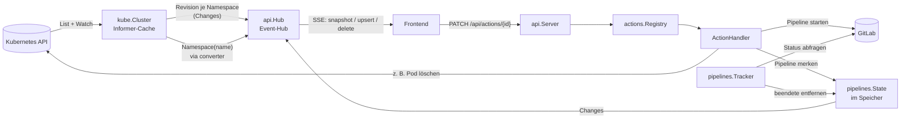

# Einarbeitung: Wie das Feature-Dashboard funktioniert

Diese Datei erklärt die Anwendung so, dass man sich damit in den Code einarbeiten kann. Sie beschreibt zuerst das
große Bild und dann die Abläufe, die man beim Lesen des Codes immer wieder trifft. Danach folgt ein Rundgang durch
das Backend, Paket für Paket. Das Frontend liegt nicht in diesem Repository; es nutzt nur die HTTP-API. Für
Konfigurationsdetails und Betrieb gibt es die `README.md`. Die verbindlichen Regeln für Änderungen stehen in
`CLAUDE.md`.

---

## 1. Worum es geht

Entwickler starten in einem Kubernetes-Cluster **Feature-Umgebungen**. Jede Umgebung ist ein eigener Namespace. Das
Dashboard zeigt auf **einer Seite**:

- je **Projekt** die zugehörigen Namespaces als **Kacheln**,
- auf jeder Kachel die **Ingress-URLs**, die **NodePort-Services** mit kopierbarer Adresse und je **Anwendungs-Service**
  (ClusterIP) einen **Punkt**: grün, wenn mindestens ein Replica ready ist, sonst rot,
- an allen Objekten **Aktionen** (z. B. Pod löschen, GitLab-Pipeline starten), **Links** (z. B. nach Kibana),
  **Kopier-Befehle** (z. B. `kubectl exec …`) und **laufende Pipelines**.

Das Frontend lädt beim Aufruf einmal den kompletten Stand. Danach bekommt es nur noch Änderungen, und zwar per
**Server-Sent Events (SSE)**.

Drei Grundsätze ziehen sich durch den ganzen Code:

1. **Alles Fachliche steckt in der `config.yaml`.** Dazu gehören Projekte, Aktionen, Links, Befehle und
   Service-Bereiche. Im Code sind keine Projekte oder Aktionen fest verdrahtet.
2. **Das Frontend ist generisch.** Es kennt keine einzelnen Aktionen. Buttons, Icons, Formulare und URLs kommen
   fertig vom Backend.
3. **Die einzige Datenquelle ist der Informer-Cache von client-go.** Das Backend hält keine eigene Kopie der
   Kubernetes-Objekte. Der einzige eigene Zustand sind die laufenden Pipelines, nur im Speicher.

---

## 2. Das große Bild

Das Wichtigste zum Verständnis: **Aktionen ändern nie direkt, was das Dashboard anzeigt.** Ein Handler löscht zum
Beispiel einen Pod. Kubernetes meldet das über den Informer, und der Event-Hub schickt die Änderung ans Frontend. Es
gibt also genau einen Weg, auf dem Daten ins Frontend kommen. Die einzige Ausnahme sind die laufenden Pipelines, die
ein Handler direkt in `pipelines.State` einträgt. Auch sie erreichen das Frontend aber nur über den Event-Hub.

---

## 3. Empfohlene Lesereihenfolge

| Schritt | Datei(en)                                                      | Warum                                                    |
|---------|----------------------------------------------------------------|----------------------------------------------------------|
| 1       | `backend/cmd/dashboard/main.go`                                | Zeigt, wie alles verdrahtet wird                         |
| 2       | `backend/internal/model/model.go`                              | Die zentralen Datentypen (`Stored*`, `NamespaceView`)    |
| 3       | `backend/internal/kube/cluster.go`                             | Woher die Daten kommen und wie Änderungen erkannt werden |
| 4       | `backend/internal/converter/convert.go`                        | Wie aus k8s-Objekten `Stored*`-Objekte werden            |
| 5       | `backend/internal/api/dto.go`                                  | Was das Frontend bekommt                                 |
| 6       | `backend/internal/api/events.go`                               | Der Event-Hub: Snapshot, Diff, SSE-Abonnenten            |
| 7       | `backend/internal/api/server.go`                               | HTTP-Routen, SSE-Handler, Aktions-Endpunkt               |
| 8       | `backend/internal/actions/actions.go`, `registry.go`           | Wie Aktionen funktionieren                               |
| 9       | ein einfacher Handler, z. B. `actions/deletepod/deletepod.go`  | Ein Handler in klein                                     |

Ein Beispiel für die Daten, die das Frontend bekommt, steht in `backend/internal/api/example-api.jsonc`. Es lohnt sich,
diese Datei parallel offen zu haben.

---

## 4. Die zentralen Abläufe

### 4.1 Start (`main.go`, Funktion `run`)

1. **Config laden:** `config.Load` liest die `config.yaml` und prüft sie vollständig. Jeder Fehler bricht den Start ab,
   und alle Fehler werden gesammelt gemeldet.
2. **Kubernetes-Client:** `kube.NewClient` nutzt die kubeconfig, im Cluster die In-Cluster-Konfiguration.
3. **Template-Registries:** `links.NewRegistry` und `copycommands.NewRegistry` parsen alle Templates. Ein Syntaxfehler
   bricht den Start ab.
4. **Datenquelle:** `kube.NewCluster` richtet die vier Informer ein. Gestartet werden sie erst später.
5. **Pipelines:** `pipelines.NewState()` legt den leeren Speicher für laufende Pipelines an.
6. **Aktionen:** Alle Handler-Typen werden in der `actions.Registry` registriert (`Register`). `Activate` erzeugt je
   aktiver Aktion aus der Config eine Handler-Instanz und ruft deren `Configure` auf.
7. **Hintergrund-Goroutinen:** `cluster.Run` (Informer), `pipelines.Tracker.Run` (GitLab-Status) und `apiServer.Run`
   (Event-Hub).
8. **HTTP-Server:** Er startet sofort. `/readyz` meldet `200` erst, wenn der Informer-Cache synchronisiert ist.

### 4.2 Eine Änderung im Cluster wird sichtbar

Beispiel: Ein Pod wird ready.

1. **Informer:** Der Pod-Informer bekommt das Update. Vorher hat `trim` (in `cluster.go`) das Objekt verkleinert.
2. **`Cluster.objectChanged`:** Gehört der Namespace des Pods zu einem Projekt, setzt `touch` eine neue **Revision**
   (einen streng steigenden Zeitstempel) für diesen Namespace und signalisiert über `Changes()`. Sonst passiert
   nichts.
3. **`Hub.Run`:** Er wacht auf und ruft `syncLocked` auf. Dort vergleicht er die Revisionen aller Namespaces mit den
   zuletzt verarbeiteten.
4. **Neuaufbau:** Für jeden geänderten Namespace ruft er `Cluster.Namespace(name)` auf. Das liest Namespace, Pods,
   Services und Ingresses aus den Listern und baut über `converter.NamespaceView` eine `model.NamespaceView`. Dabei
   werden die Replicas der Services und benannte targetPorts neu aufgelöst.
5. **DTOs:** `Server.buildNamespace` (`dto.go`) macht daraus den DTO-Baum für das Frontend und hängt an jedes
   Objekt Aktionen, Links, Kopier-Befehle und laufende Pipelines (`Server.extras`).
6. **Diff:** `flatten` zerlegt den Baum in einzelne Objekte als JSON-Bytes. `diff` vergleicht sie mit dem alten Stand
   und erzeugt `delete`- und `upsert`-Events. Im Beispiel sind das ein `upsert` für den Pod und eventuell eines für
   den Service, weil sich `running` ändert.
7. **Verteilen:** Jeder SSE-Abonnent bekommt die Events in seinen Puffer. Ist er zu langsam, trennt der Hub die
   Verbindung, und der Browser verbindet sich mit frischem Snapshot neu.

Wichtig: Es gibt **keine inkrementelle Logik** der Art „Pod geändert, also Service anpassen“. Der Hub baut immer den
ganzen Namespace neu und vergleicht das Ergebnis. Das ist einfach und schließt Inkonsistenzen aus. Pro Event ist es
etwas mehr Arbeit, die Namespaces sind aber klein.

### 4.3 Ein Browser verbindet sich (`GET /api/events`)

1. **`Server.handleEvents`** prüft, ob der Cache bereit ist, und ruft dann `Hub.Subscribe` auf.
2. **`Subscribe`** gleicht zuerst ab (`syncLocked`) und baut dann aus den gespeicherten Teilbäumen den **Snapshot**
   (`snapshotLocked`). Das passiert unter demselben Lock wie das Verteilen. Zwischen Snapshot und dem ersten Event
   geht deshalb nichts verloren.
3. **Senden:** Der Handler schickt zuerst `event: snapshot` und danach alle Events aus dem Abo-Kanal. Alle 25 Sekunden
   sendet er einen `: ping`-Kommentar.
4. **Ende:** Die Verbindung endet, wenn der Browser trennt, der Abonnent zu langsam ist oder der Server herunterfährt.

### 4.4 Eine Aktion wird ausgeführt (`PATCH /api/actions/{id}`)

1. **Dialog:** Das Frontend zeigt einen Dialog mit den Formular-Feldern der Aktion und schickt dann
   `{object: {kind, namespace, name}, inputs}`.
2. **Objekt laden:** `Server.handleAction` lädt das Objekt über `Server.load` (Typ `actions.StoredObject`: Ref, Objekt,
   Projekt).
3. **Prüfen und ausführen:** `Registry.Execute` prüft, ob die Aktion im Projekt erlaubt ist (`projects` aus der
   Config), ob der Handler sie für das Objekt anbietet (`IsApplicable`) und ob die Eingaben zu den Formular-Feldern
   passen (`validate`). Danach ruft sie `Handler.Execute` auf.
4. **Ergebnis:** Der Handler ändert den Cluster oder startet etwas extern und liefert ein `Result{Success, Message}`.
   Bei Erfolg antwortet die API mit `200`, sonst mit `422` und der Meldung des Handlers als `{"error": "…"}`.
5. **Anzeige:** Die eigentliche Änderung erscheint, sobald der Informer sie meldet (Ablauf 4.2).

### 4.5 Eine GitLab-Pipeline wird verfolgt

1. **Start:** `gitlabpipeline.Trigger.Run` startet die Pipeline über die Trigger-API.
2. **Merken:** Ist `status-token-env` konfiguriert, ruft der Trigger `pipelines.State.Set` auf. Der Eintrag landet im
   Speicher.
3. **Anzeigen:** `State` erhöht die Pipeline-Revision des Namespaces. Der Hub achtet auch darauf (`RevisionSource`)
   und schickt ein `upsert` mit `pipelines: [...]`.
4. **Status abfragen:** `pipelines.Tracker` fragt alle `poll-interval` den Status bei GitLab ab (`PipelineStatus` am
   Trigger). Beendete Pipelines entfernt er mit `State.Remove`, worauf ein weiteres `upsert` ohne die Pipeline folgt.
5. **Neustart:** Der Stand ist danach leer. Bereits laufende Pipelines werden nicht mehr markiert, das ist bewusst
   so.

---

## 5. Backend-Rundgang (`backend/`)

### `cmd/dashboard`
Startpunkt. Hier steht auch die einzige Liste der verfügbaren Handler-Typen (`registry.Register(...)`).

### `internal/config`
- **Was:** Lädt und prüft die `config.yaml`. Jeder Abschnitt hat einen eigenen Typ, z. B. `Project`,
  `ActionHandlerConfig`, `Link`, `CopyCommand`, `ClusterConfig` und `PipelinesConfig`.
- **Prüfung:** `Validate` sammelt alle Fehler. Standardwerte setzt `applyDefaults`.
- **Hinweis:** Die YAML-Prüfung ist nicht strikt. Unbekannte Schlüssel werden ignoriert, alte Configs starten also
  weiter.

### `internal/model`
- **`Stored*`-Typen:** die reduzierte Form der vier Kubernetes-Typen, mit dem, was das Dashboard braucht.
- **`NamespaceView`:** alle Objekte eines Namespaces.
- **`Kind`/`ObjectRef`:** identifizieren ein Objekt.
- **Verwendung:** Diese Typen sind die gemeinsame Sprache von Converter, API, Aktionen und Templates.

### `internal/kube`
- **`client.go`:** baut den Kubernetes-Client.
- **`cluster.go` (`Cluster`):** die Datenquelle.
  - **Informer:** Es gibt vier, mit `trim` als Transform. `trim` entfernt `managedFields` und reduziert bei Pods Spec
    und Status. Labels und Annotations bleiben erhalten.
  - **Event-Handler:** `namespaceChanged` prüft über den `project.Matcher`, ob ein Namespace dazugehört, und
    aktualisiert die Revisions-Map. `objectChanged` setzt eine neue Revision für den Namespace eines Objekts, wenn
    der Namespace zu einem Projekt gehört.
  - **Lesen:** `Namespace(name)`, `Get(ref, out)`, `Services(namespace)`, `NamespaceRevisions()`, `Changes()`.
- **Regel:** Objekte aus den Listern zeigen in den Cache und dürfen **nie verändert** werden. Nur `kube` und
  `converter` fassen sie an.

### `internal/converter`
- **Was:** reine Funktionen von k8s-Objekt zu `Stored*` (`Namespace`, `Pod`, `Service`, `Ingress`).
- **`NamespaceView`:** konvertiert alles eines Namespaces, sortiert es und ruft `ResolveService` auf.
- **`ResolveService`:** ermittelt die Replicas über den Selector und löst benannte `targetPort`s über die
  Container-Ports der Replicas auf.

### `internal/project`
- **`matcher.go`:** Ein Namespace gehört zu einem Projekt, wenn er alle `namespace-labels` trägt.
- **`areas.go`:** ordnet einen Service über seine Labels den Service-Bereichen zu (`ServiceAreaIDs`). Passt keiner,
  landet er in `others`.

### `internal/api`
- **`server.go`:**
  - Routen: `/api/events`, `/api/snapshot` (Stand einmalig als JSON), `PATCH /api/actions/{id}`, Health, OpenAPI
    und Swagger.
  - Die Schnittstelle `Source` beschreibt, was der Server von der Datenquelle braucht.
  - `extras` hängt Aktionen, Links, Befehle und Pipelines an ein Objekt.
  - Optionen werden per `With…` gesetzt (`WithLinks`, `WithCopyCommands`, `WithCluster`, `WithPipelines`,
    `WithStaticDir`).
- **`dto.go`:**
  - Die Ausgabetypen sind `NamespaceDTO`, `ServiceDTO`, `PodDTO`, `NodePortServiceDTO` und `IngressDTO`.
  - `buildNamespace`/`buildService` bauen den Baum.
  - `ingressURLs` und `nodePortAddresses` berechnen fertige Adressen.
  - `flatten` zerlegt den Baum für den Diff.
  - Jedes Objekt trägt `kind`, `name` und `parents` (`ObjectHeader`), damit das Frontend Events direkt einsortieren
    kann.
- **`events.go`:** der Event-Hub (`Hub`).
  - `syncLocked` erkennt geänderte Namespaces, `load` baut sie auf, `diff` erzeugt die Events.
  - `Subscribe` und `snapshotLocked` bedienen neue Abonnenten; `Snapshot` liefert den Stand ohne Abo
    (für `/api/snapshot`).
  - Stündlich (`fullResyncInterval`) baut der Hub alles neu auf, als Sicherheitsnetz.
- **`static.go`:** liefert optional statische Dateien aus (`--static-dir`, im Image nicht genutzt). Unbekannte Pfade
  bekommen `index.html`.
- **`openapi.yaml`:** die API-Beschreibung, eingebettet und unter `/api/openapi.yaml` erreichbar.
- **`example-api.jsonc`:** ein kommentiertes Beispiel des Snapshots.

### `internal/actions`
- **`actions.go`:** Das Interface `Handler` mit vier Methoden:
  - `Configure(extra)` liest die handler-spezifische Konfiguration und prüft sie beim Start.
  - `IsApplicable(obj)` legt fest, ob die Aktion an diesem Objekt angeboten wird.
  - `FormFields(obj)` beschreibt die Eingaben; `nil` heißt nur Bestätigung.
  - `Execute(ctx, obj, inputs)` führt die Aktion aus und liefert ein `Result`.

  Dazu kommen `Deps` (Kubernetes-Client, Lesezugriff auf den Cache, Pipeline-State und der eigene `ActionName`) sowie
  `ObjectReader`.
- **`registry.go`:**
  - `Register` macht einen Handler-Typ bekannt, `Activate` erzeugt je Aktion eine Instanz.
  - `ActionsFor` liefert die Aktionen, die an einem Objekt angeboten werden.
  - `Execute` führt eine Aktion aus und prüft dabei Projekt, Anwendbarkeit und Eingaben (`validate`).
  - Ein Handler-Typ kann mehrere Aktionen bedienen, z. B. `gitlab-pipeline`.
- **Handler-Typen:**
  - `deletepod` löscht einen Pod.
  - `restartservice` löscht alle Pods eines Services, damit ihr Controller sie neu startet.
  - `nodeportservice` erstellt bzw. löscht einen NodePort-Service mit ownerReference auf den Basis-Service.
  - `gitlabpipeline` startet Pipelines. Die Logik steckt in `trigger.go` und wird auch von `missingservices`
    genutzt.
  - `missingservices` bietet die fehlenden konfigurierten Services zur Auswahl an und startet für die Auswahl eine
    Pipeline.
  - `assignteam` ordnet einen Namespace einem Team zu: Single-Select aus dem Abschnitt `teams`, setzt bzw. entfernt
    das Team-Label am Namespace per Merge-Patch.
  - `nightlyscaledown` nimmt einen Namespace vom nächtlichen Herunterskalieren aus: setzt (`mark`) bzw. entfernt
    (`unmark`) das feste Label `ExclusionLabelKey`/`ExclusionLabelValue`, das auch der CronJob auswertet. Zwei
    Aktionen, `IsApplicable` bietet jeweils nur die passende an.

### `internal/objecttemplate`, `internal/links`, `internal/copycommands`
- **`objecttemplate`:** Go-Templates mit den Daten eines Objekts (`Data`: `.Kind .Name .Namespace .Project .Labels
  .Annotations .Selector .Vars .Services .Container`). Zusätzliche Funktionen sind `rison`, `pathescape`, `replace`,
  `join`, `shellquote`, `trimPrefix` und `extractRenewJiraTicketNumber`. Fehlende Map-Schlüssel sind ein Fehler.
- **`links`:** rendert die konfigurierten Links je Objekt und lässt nur absolute http(s)-URLs zu.
- **`copycommands`:** rendert die Kopier-Befehle. Bei Pods rendert es je Container einmal; unterscheiden sich die
  Ergebnisse, entsteht je Container ein eigener Befehl.

### `internal/pipelines`
- **`state.go`:** laufende Pipelines je Objekt und Aktion, nur im Speicher.
  Es gibt eine Revision je Namespace und `Changes()`, genau wie beim Cluster.
- **`tracker.go`:** fragt den Status ab und entfernt beendete, unbekannte und nicht mehr verfolgte Pipelines. Die
  Status-Abfrage selbst ist über `StatusChecker` austauschbar, der `gitlabpipeline.Trigger` erfüllt das Interface.

### `internal/testsource`
Eine In-Memory-Datenquelle **nur für Tests**. Sie erfüllt `api.Source` und `actions.ObjectReader`. Mit
`Update(func(tx) …)` legen Tests Objekte direkt an, ohne Fake-Cluster und Informer.

### Zweite Anwendung: `cmd/nightly-scale-down`
Ein CronJob, kein Teil des Dashboards. Er liest einmal alle Namespaces mit dem Ausnahme-Label der Aktion
`nightly-scale-down-exclusion` und startet die GitLab-Pipeline für das nächtliche Herunterskalieren. Die
ausgenommenen Namespaces übergibt er komma-getrennt als Pipeline-Input `EXCLUDE_NAMESPACES`. Konfiguration nur über
Umgebungsvariablen (`configFromEnv` in `scaledown.go`), GitLab über `gitlabpipeline.Trigger.Start`. Der Code liegt
nur im Paket `main` der Anwendung, das Dashboard kennt ihn nicht. Details in der `README.md`.

---

## 6. Regeln, die man kennen muss

- **Nur vier Kubernetes-Typen:** Namespace, Service, Ingress und Pod werden beobachtet, keine weiteren. Die
  Es gibt keine Persistenz; die laufenden Pipelines liegen nur im Speicher.
- **Lister-Objekte nie verändern.** Neue Felder liest man im `converter`. Braucht man dafür Pod-Felder, die `trim`
  entfernt, muss man `trim` erweitern.
- **Keinen Zustand an Objekten der Feature-Umgebungen ablegen** (Annotationen o. Ä.). ArgoCD verwaltet sie mit
  Self-Heal und setzt solche Änderungen zurück.
- **Kein aktionsspezifischer Code im Frontend.** Fehlt dem Frontend eine Information, wird die API erweitert.
- **Bei API-Änderungen alles mitziehen:** `openapi.yaml` und `example-api.jsonc` (das Frontend richtet sich danach).
- **Proxy und Company-CA:** Ausgehende Aufrufe laufen über einen Firmen-Proxy mit eigener CA. HTTP-Clients nutzen
  deshalb den Standard-Transport von Go, der `HTTPS_PROXY`/`NO_PROXY` und `SSL_CERT_DIR` beachtet. Kein eigener
  `Transport` ohne Proxy und CA. Konfiguriert wird im Cluster über `backend/deploy/network.example.yaml`.
- **Genau ein Replica.** Laufende Pipelines liegen im Speicher, und jede Replica hätte eigene
  Event-Streams.

---

## 7. Typische Erweiterungen

**Neue Aktion:**
1. Neues Paket unter `internal/actions/<name>` anlegen, `actions.Handler` implementieren und eine Factory
   `New(deps actions.Deps) actions.Handler` schreiben.
2. In `main.go` mit `registry.Register("<handler-typ>", <paket>.New)` registrieren.
3. Die Aktion in der `config.yaml` unter `action-handlers` eintragen, mit `projects`, Titel, Icon und
   `extra-handler-configs`.
4. Am Frontend ist nichts zu tun (es ist generisch).

Gute Vorlage: `deletepod` (einfach) oder `nodeportservice` (mit Formular und Prüfung gegen den Cache).

**Neues Feld in der API ausliefern:**
1. Gibt es das Feld im k8s-Objekt noch nach `trim`? Sonst `trim` erweitern.
2. Im `model` und im `converter` übernehmen.
3. Im passenden DTO in `dto.go` ausgeben.
4. `openapi.yaml` und `example-api.jsonc` anpassen. Die Darstellung erfolgt im (separaten) Frontend.

Events, Diff und Snapshot passen sich automatisch an.

**Neuer Link oder Kopier-Befehl:** Nur Config, kein Code: `links` bzw. `copy-commands` in der `config.yaml`.

---

## 8. Tests und lokales Arbeiten

- **Befehle:** `make test` (Go mit `-race`), `make lint`, `make build`. `make run` startet lokal gegen
  `KUBECONFIG` mit `backend/config.example.yaml`.
- **Wichtige Testdateien:**
  - `internal/api/server_test.go`: Snapshot, Events, SSE-Stream, Aktionen. Nutzt `testsource` und die Helfer
    `subscribe`/`syncHub`.
  - `internal/kube/cluster_test.go`: Informer mit `fake.NewClientset`, Revisionen, `trim`.
  - `internal/converter/converter_test.go`: Auflösung von Replicas und targetPorts.
  - `internal/pipelines/pipelines_test.go`: State und Tracker.
- **Stream ansehen:** `curl -N localhost:8080/api/events` zeigt den Snapshot und danach jede Änderung. Gut geeignet,
  um nachzuvollziehen, was ein Pod-Neustart oder eine Aktion auslöst.
- **API ausprobieren:** `/api/swagger` zeigt die Swagger-UI.
